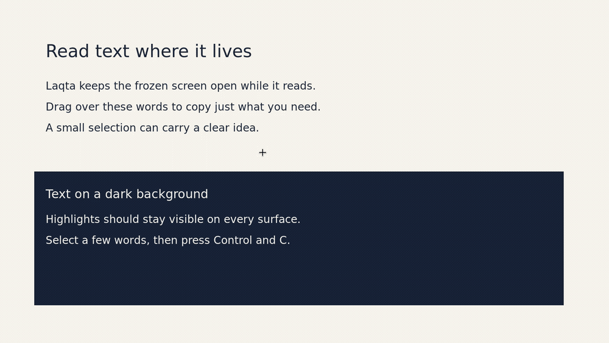

# Text read in place: a real run

Screenshots and a screen recording of Laqta reading text on the overlay (ADR 031). They come from
a real run, not mock-ups: a debug build on Linux under Xvfb (1600×900) with Openbox and Mesa's
software Vulkan renderer, with PP-OCR as the recogniser.

| File | What it shows |
|---|---|
| `01-reading.png` | The band of light crossing the selection and the "Reading text" bar |
| `02-read.png` | Every word highlighted where it is; the bar says all the text was copied |
| `03-selected.png` | Four words picked with a drag, in blue; the bar offers Copy |
| `04-copied.png` | Right after Ctrl+C: "Copied 4 words" |
| `06-dark-redrawn.png` | A new region drawn outside the first one, read again, on a dark background |
| `08-region-ocr.png` | An ordinary region capture, then Shift+C: the same text layer in a capture session |

Seen in this run: the word boxes follow the text closely, the highlights show on light and dark
backgrounds, and the bar fits under the selection. The clipboard was checked by pasting into
another program.

Not covered by this run: Windows, macOS, Wayland, a real GPU, several monitors or scale factors,
and reduced motion. On this Xvfb and Openbox setup the overlay did not get the keyboard by
itself, so Ctrl+C and Escape were sent after giving it focus explicitly; the pointer and the
bar's buttons needed nothing.
